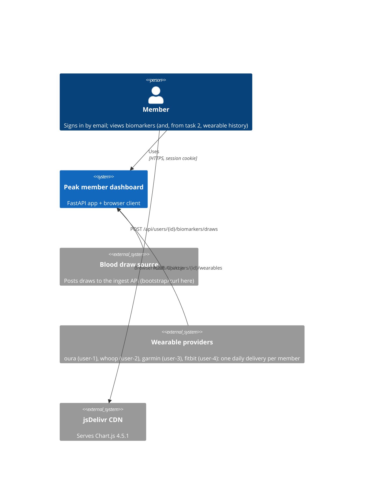
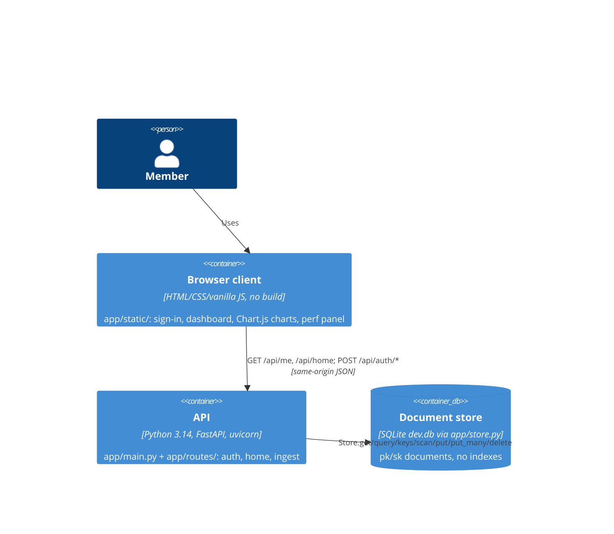

## Summary
There's one deployable: a FastAPI process (`app/main.py`) that serves both the JSON API and a no-build vanilla JS client. Persistence is a partitioned document store over SQLite (`dev.db`). Members sign in by email only. Blood draws and wearable deliveries arrive through unauthenticated ingest endpoints. Chart.js is the only third-party client library, loaded from a CDN.

## Context (level 1)

- Each member uses exactly one wearable provider. Providers differ in field names, units, nesting and metric coverage: for example oura/garmin/fitbit use `heart_rate_data.resting_hr_bpm`, while whoop uses `heart_rate.resting.bpm` with tz-offset timestamps. Some days are missing, some fields are null, and some days are redelivered (`_r2` files) with a corrected value and a new `upload_id`. Evidence: `data/wearables/*/`, `TASK_2.md`.
- In this exercise, ingest is replayed by `scripts/bootstrap.py` (draws) and `scripts/ingest-wearable-data.py` (wearables).

## Containers (level 2)

| Container | Notes | Evidence |
| --- | --- | --- |
| API | Routers: `auth` (login/logout/me), `home` (`/api/home`, `/api/biomarkers`), `ingest` (`/api/users/{user_id}/…`). Every response is `{"data", "meta"}` with snake_case fields. Timing middleware sets `X-Response-Time-Ms` | `app/main.py`, `app/routes/`, `app/models.py:12`, `app/timing.py` |
| Browser client | Served at `/` and `/static/`; one process, one port, no CORS. Calls `/api/me` on load, then `/api/home`, and renders results grouped by category. `perf.js` wraps `fetch` for a request-timing panel and holds the Chart.js example | `app/static/app.js`, `app/static/perf.js`, `app/static/index.html:41` |
| Document store | One SQLite table `documents(pk, sk, value)`, opened per request via `Depends(get_store)`. Every call logs at INFO, which is the way to see access patterns | `app/store.py` |

## Related
- [Business constraints](/project-context/10k/business-constraints.md)
- [Project structure](/project-context/10k/technical/project-structure.md)
- [ADR-0001: Partitioned document store](/project-context/10k/technical/adrs/0001-partitioned-document-store.md)
- [ADR-0002: Draw results keep as-at-draw ranges](/project-context/10k/technical/adrs/0002-draw-results-keep-as-at-draw-ranges.md)
