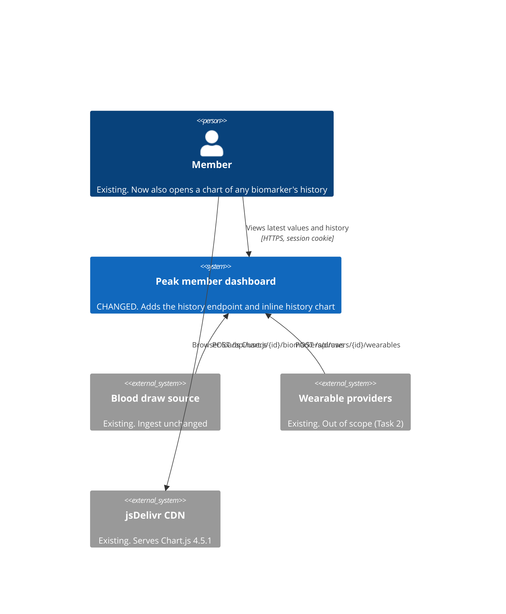

## Summary
Nothing changes at context level. No new people or external systems are involved: the member gets a new capability (biomarker history) inside the existing dashboard, Chart.js still comes from the CDN, and ingest is untouched (k2). The **changed** marker below is the dashboard system, because it gains behaviour.

| Element | Status | Note |
| --- | --- | --- |
| Member | existing | Same sign-in and session cookie |
| Peak member dashboard | **changed** | See [containers](2-containers.md) |
| Blood draw source, wearable providers, CDN | existing | No new dependency; no date adapter needed (linear time axis, k8) |

## Related
- [Containers (level 2)](2-containers.md)
- [10k C4 context and containers](/project-context/10k/technical/architecture/c4-context-containers.md)
- [Plan](../plan.md)
