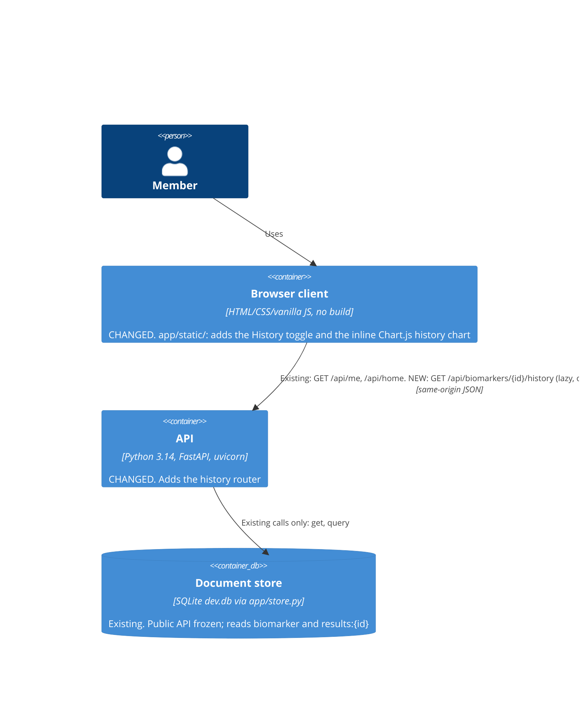

## Summary
The browser client and the API both **change**, while the document store stays as it is. The client lazily calls a **new** `GET /api/biomarkers/{id}/history` only when a member expands a card, so `/api/home` and its 35 ms p95 budget don't move (d1, k4). The API reads with the store's existing `get` and `query` calls, so there's no store change and no new partition.

| Container | Status | Change |
| --- | --- | --- |
| Browser client | **changed** | History toggle on each marker card, lazy fetch, chart and empty state (`app.js`, `styles.css`) |
| API | **changed** | New `history` router wired in `app/main.py`; `/api/home` untouched |
| Document store | existing | Reads `get("biomarker", id)` and `query("results:{id}")`. No new partition or write path |

## Related
- [Context (level 1)](1-context.md)
- [Components (level 3)](3-components.md)
- [History API shape](../origins/biomarker-history/shaping-content/history-api-shape.md)
- [ADR-0001: Partitioned document store](/project-context/10k/technical/adrs/0001-partitioned-document-store.md)
