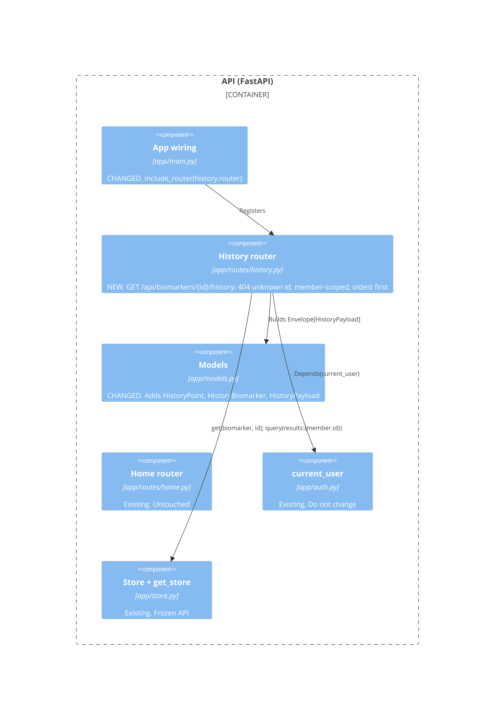
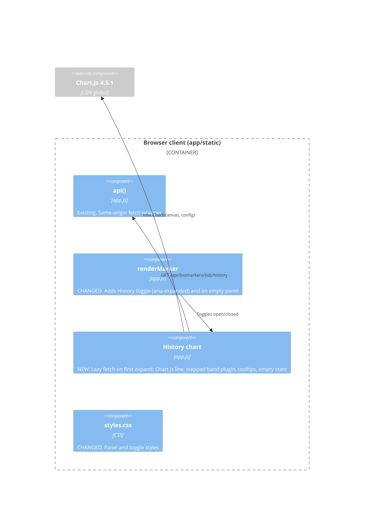

## Summary
In the API, a **new** history router depends on the existing `current_user` and `get_store` dependencies plus **new** payload models, and it never touches the home router. In the client, the marker card renderer **changes** to add a toggle, and a **new** history chart component fetches the data and draws the line, the stepped as-at-draw bands (d2) and the tooltips.

## API

## Browser client

| Component | Status | Responsibility |
| --- | --- | --- |
| History router | **new** | Validate the id against the catalogue, filter the member's draws to one biomarker, return points oldest first |
| Models | **changed** | Response payload types only; stored-document models are untouched |
| App wiring | **changed** | One `include_router` line |
| `renderMarker` | **changed** | Card keeps the latest value and unit visible (k1) and gains the toggle |
| History chart | **new** | Fetch once per card, render the chart or "No history yet", keep the chart instance for re-expanding |
| Home router, auth, store | existing | Not modified |

## Related
- [Containers (level 2)](2-containers.md)
- [Code (level 4)](4-code.md)
- [Data survey](../data-survey.md)
