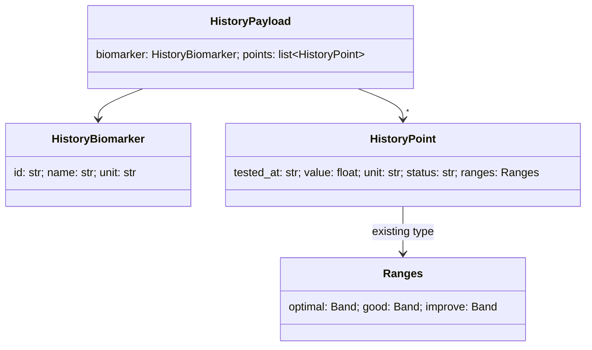

## Summary
The epic is small: about one new route module, three new Pydantic models, one changed render function plus two new client functions, and one new test file. No domain layer is added. The logic is a single filter over one partition, and an extra layer wouldn't pay for itself in this epic (the "right-size" rule). The pure point-building step is kept in its own function so the tests can drive it.

## Server
| Module | Item | Status | Responsibility |
| --- | --- | --- | --- |
| `app/models.py` | `HistoryPoint {tested_at, value, unit, status, ranges: Ranges}` | **new** | One draw's reading with its as-at-draw ranges (ADR-0002, d2) |
| `app/models.py` | `HistoryBiomarker {id, name, unit}` | **new** | Catalogue identity for the chart title and axis label |
| `app/models.py` | `HistoryPayload {biomarker: HistoryBiomarker, points: list[HistoryPoint]}` | **new** | Response body inside the existing `Envelope` |
| `app/routes/history.py` | `history_points(draws, biomarker_id) -> list[HistoryPoint]` | **new** | Pure: pick the biomarker's result from each draw, skip draws that lack it, oldest first. If two draws share a date, sort key order breaks the tie |
| `app/routes/history.py` | `biomarker_history(biomarker_id, member, store)` | **new** | `GET /api/biomarkers/{biomarker_id}/history`. `404` if `store.get("biomarker", id)` is None, otherwise `query(f"results:{member.id}", ResultsDocument)` → `history_points`. `meta: {count}` |
| `app/main.py` | `include_router(history.router)` | **changed** | Wiring |
| `app/routes/home.py`, `app/auth.py`, `app/store.py` | (all) | existing | Untouched |

## Client (`app/static/`)
| Item | Status | Responsibility |
| --- | --- | --- |
| `renderMarker(result)` | **changed** | Adds a `History` button (`aria-expanded`, the `aria-controls` panel) and a hidden panel holding a canvas |
| `toggleHistory(button, panel, biomarkerId)` | **new** | Flip `aria-expanded` and visibility; on the first open call `loadHistory`; later opens reuse the chart |
| `loadHistory(panel, biomarkerId)` | **new** | `api(...)`; empty `points` → "No history yet"; otherwise `new Chart` with a linear x-axis (epoch ms, `formatDate` ticks), tooltips showing value, unit, date and status, and `bandPlugin` |
| `bandPlugin` | **new** | `beforeDatasetsDraw`: for each point, fill the improve/good/optimal rects from this draw's x to the next draw's x (the last one runs to the chart edge) |
| `.history-*` in `styles.css` | **new** | Toggle and panel layout |

## Tests (`tests/test_history.py`, new)
Driven test-first through `TestClient` with the `conftest.py` fixtures, as in `tests/test_home.py`. The cases are the ones in [plan](../plan.md#test-strategy): order, member scoping, missing-from-draw, `404`, empty `200`, drifted per-point ranges, and `401`. The client is checked by hand (no JS harness).

## Related
- [Components (level 3)](3-components.md)
- [Plan](../plan.md)
- [ADR-0002: Draw results keep as-at-draw ranges](/project-context/10k/technical/adrs/0002-draw-results-keep-as-at-draw-ranges.md)
